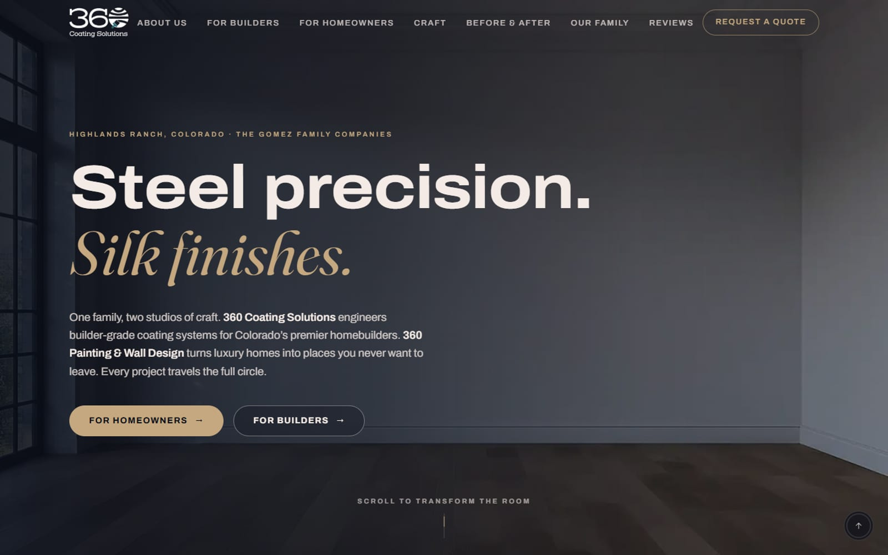
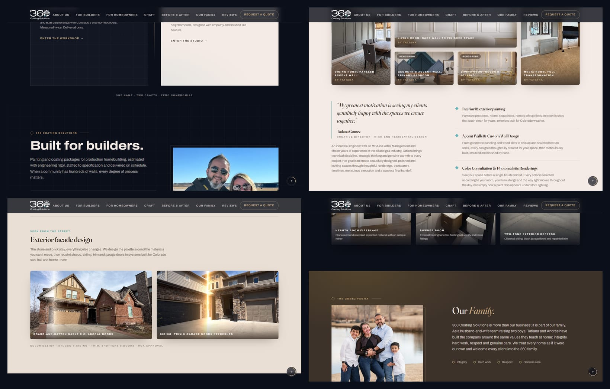
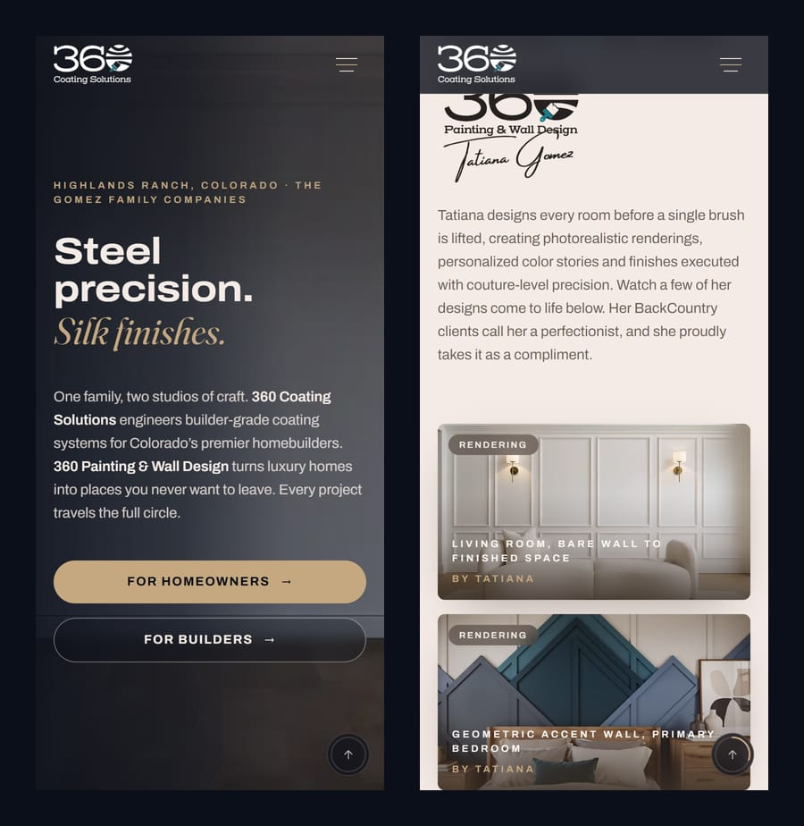

<div align="center">



# 360 Coating Solutions

**One family, two studios of craft — industrial coating for Colorado's homebuilders and luxury painting & wall design for homeowners — told as a single scroll-driven story.**

<br/>

[](https://360coatingsolutions.com/)


[Overview](#overview) · [Highlights](#highlights) · [Screenshots](#screenshots) · [Architecture](#architecture) · [Local development](#local-development) · [Deployment](#deployment)

</div>

---

## Overview

**360 Coating Solutions** (B2B coating systems for production homebuilders) and **360 Painting & Wall Design** (high-end residential interiors) are two brands of the same family company in Highlands Ranch, Colorado. The brief was to present both without splitting the family in two: one site, one story, two audiences that each find their own door.

The answer is the **"Steel & Silk"** design system — *Carbon* for the industrial side, *Sand* for the residential one — joined by a single gold thread. The page opens on an empty room that turns into a finished living room as you scroll, then lets builders and homeowners branch off into their own wing.

## Highlights

| | |
|---|---|
| 🎞️ **A hero you scroll through** | A 6-second "empty room → sunlit living room" film is pre-extracted into **72 WebP frames** and painted on a full-bleed `<canvas>` by GSAP ScrollTrigger. Scrolling down plays the transformation, scrolling up rewinds it — the only technique that behaves identically on iOS, Android, Windows and macOS. |
| 🚪 **The Steel ↔ Silk gateway** | On large screens the section pins while both brand worlds slide in from opposite sides and a gold beam sweeps across. Small screens get the same content as a calm stacked layout. |
| 🎬 **Video that never competes with itself** | **10 compressed H.264 reels** with WebP posters. An `IntersectionObserver` plays each one only while it is on screen, so the browser never decodes several videos at once. |
| ⭕ **Opening moment** | A preloader ring draws 0 → 360° while the counter climbs, then the curtain lifts. |
| 📐 **Zero layout shift** | Every image, video and frame has explicit dimensions before it loads; fonts (Fraunces + Archivo variable) are self-hosted, so text never reflows and no third-party font request is made. |
| ✉️ **A contact form that protects itself** | Honeypot field, `express-rate-limit` (5 requests / 10 min per IP), server-side validation, header-injection sanitising and per-audience routing (`X-360-Inquiry-Type: Builder / Homeowner`) through the Resend API. The API key never reaches the browser. |
| ♿ **Accessible by default** | WCAG AA contrast on both palettes, semantic landmarks, `prefers-reduced-motion` honoured by the GSAP layer, and FAQ structured data for search. |

## Screenshots

<div align="center">
  
  <br/><sub><b>Desktop</b> — the builders wing, the interiors gallery, exterior facade design and the family behind the company.</sub>
  <br/><br/>
  
  <br/><sub><b>Mobile</b> — same story, re-composed for a phone rather than shrunk.</sub>
</div>

## Architecture

```
360-coating-solutions/
├── index.html             SEO meta, Open Graph, JSON-LD (FAQ)
├── src/
│   ├── components/        17 components — Hero, Gateway, CoatingWing, PaintingWing,
│   │                      Transformations, VideoReel, Reviews, Family, Faq, Contact…
│   ├── content/           site.js · images.js · transformations.js — all copy and data
│   ├── assets/frames/     72-frame hero sequence (WebP)
│   ├── assets/videos/     web-compressed reels + posters
│   ├── lib/gsap.js        one GSAP/ScrollTrigger registration for the whole app
│   └── index.css          design tokens (@theme)
└── server/index.js        Express: static dist/ + POST /api/contact
```

| Design token | Value | Role |
|---|---|---|
| Carbon | `#0b0f19` | Industrial brand, dark surfaces |
| Sand | `#f5ebe6` | Residential brand, light surfaces |
| Gold | `#c5a880` | The thread between both brands |
| Teal | `#2a9da8` | Accent and focus |

One Node process serves the built static site and the contact endpoint, so production is a single Railway service.

## Local development

**Prerequisites:** Node.js 18+.

```bash
npm install
cp .env.example .env      # add RESEND_API_KEY to send email
```

Run the two processes in separate terminals:

```bash
npm run dev       # Vite + HMR on http://localhost:5173
npm run server    # Express contact API on http://localhost:3001
```

Vite proxies `/api/*` to Express, mirroring production. Build with `npm run build` (output in `dist/`).

### Where things live

| What | Where |
|---|---|
| Contact info & socials | `src/content/site.js` → `CONTACT` |
| Services & FAQs | `src/content/site.js` → `COATING_SERVICES` / `FAQS` |
| Testimonials | `src/content/site.js` → `TESTIMONIALS` |
| Images | `src/assets/img/`, registered in `src/content/images.js` |
| Colours & fonts | `src/index.css` (`@theme`) |

## Deployment

Single service on **Railway**, from the repository root: Railway runs `npm install`, `npm run build`, then `npm start`.

| Variable | Purpose |
|---|---|
| `RESEND_API_KEY` | Resend API key (server only) |
| `RESEND_FROM` | Verified sender address |
| `CONTACT_EMAIL_ADMIN` | Default inbox for new inquiries |
| `CONTACT_EMAIL_HOMEOWNER` / `CONTACT_EMAIL_BUILDER` | Optional per-audience inboxes |

---

<div align="center">
<sub>Designed and engineered by <a href="https://www.devleck.com">Devleck</a> — Aleck Martinez.</sub>
</div>
